# Practica-IAW-4.1- Ejercicios con AWS CLI

## Ejercicio 1. Crear un grupo de seguridad para las máquinas del Backend con el nombre backend-sg con  Añada las reglas Acceso SSH (puerto 22/TCP) desde cualquier dirección IP y Acceso al puerto 3306/TCP desde cualquier dirección IP al grupo de seguridad:

```bash
#!/bin/bash
set -x

# Deshabilitamos la paginación de la salida de los comandos de AWS CLI
export AWS_PAGER=""

# Importamos las variables de entorno
source .env

# Creamos el grupo de seguridad: backend-sg
aws ec2 create-security-group \
    --group-name $SECURITY_GROUP_BACKEND \
    --description "Reglas para el backend"

# Creamos una regla de accesso SSH
aws ec2 authorize-security-group-ingress \
    --group-name $SECURITY_GROUP_BACKEND \
    --protocol tcp \
    --port 22 \
    --cidr 0.0.0.0/0

# Creamos una regla de accesso para MySQL
aws ec2 authorize-security-group-ingress \
    --group-name $SECURITY_GROUP_BACKEND \
    --protocol tcp \
    --port 3306 \
    --cidr 0.0.0.0/0
```

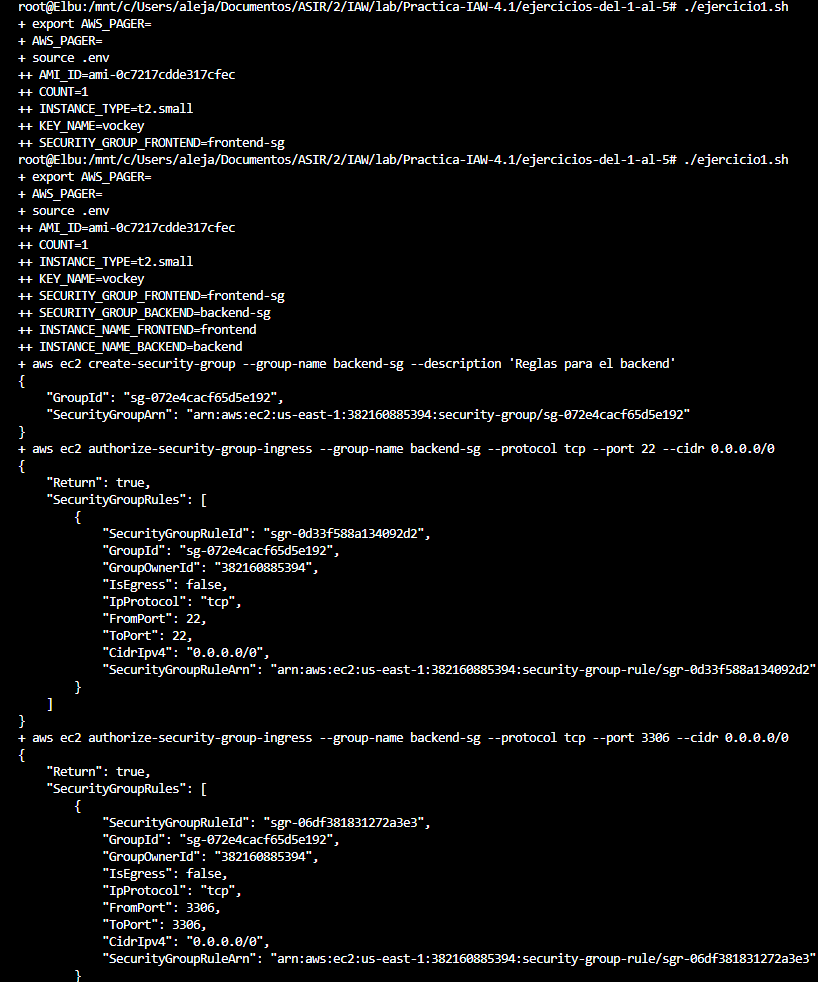

No se ve toda la ejecución del script porque es demasiado grande, pero para verificar que se ha hecho correctamente, voy a ir al ec2 en amazon para ver que a creado el grupo con las reglas correctamente.

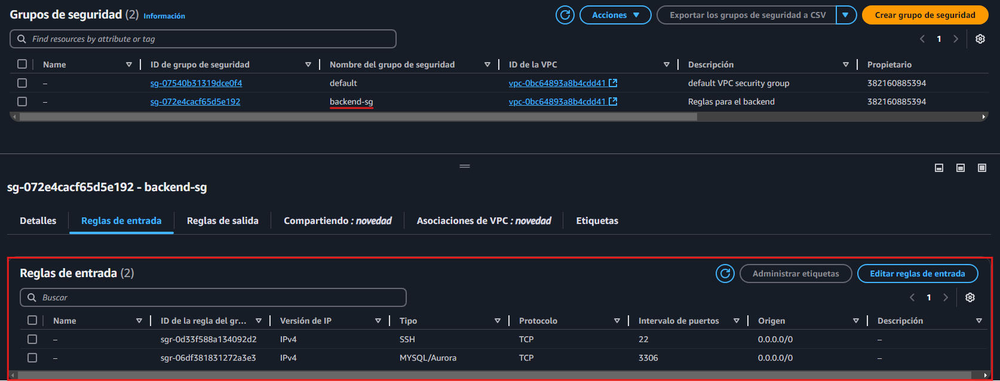

Como se puede ver, a creado el grupo con el nombre indicado y con las reglas correctamente.

## Ejercicio 2. Crea una instancia EC2 para la máquina del Backend con las siguientes características. Identificador de la AMI: ami-08e637cea2f053dfa. Número de instancias: 1, Tipo de instancia: t2.micro, Clave privada: vockey, Grupo de seguridad: backend-sg, Nombre de la instancia: backend

```bash
#!/bin/bash
set -x

# Deshabilitamos la paginación de la salida de los comandos de AWS CLI
export AWS_PAGER=""

# Variables de configuración
source .env

# Creamos una intancia EC2 para el backend
aws ec2 run-instances \
    --image-id $AMI_ID \
    --count $COUNT \
    --instance-type $INSTANCE_TYPE \
    --key-name $KEY_NAME \
    --security-groups $SECURITY_GROUP_BACKEND \
    --tag-specifications "ResourceType=instance,Tags=[{Key=Name,Value=$INSTANCE_NAME_BACKEND}]"
```

El archivo de variables para este ejercicio quedaría tal que así:

```bash
AMI_ID=ami-08e637cea2f053dfa
COUNT=1
INSTANCE_TYPE=t2.micro
KEY_NAME=vockey

SECURITY_GROUP_FRONTEND=frontend-sg
SECURITY_GROUP_BACKEND=backend-sg

INSTANCE_NAME_FRONTEND=frontend
INSTANCE_NAME_BACKEND=backend
```


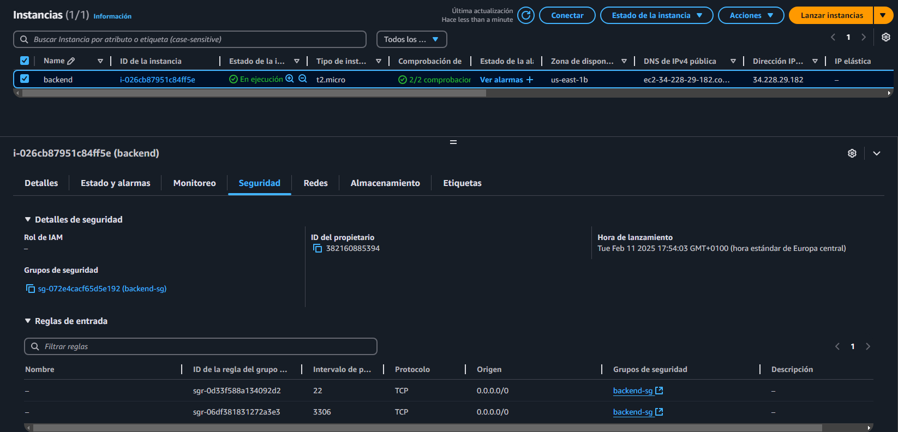


## Ejercicio 3.1. Crear un script para crear la infraestructura de la práctica 1.11.

```bash
#!/bin/bash
set -x

# Deshabilitamos la paginación de la salida de los comandos de AWS CLI
export AWS_PAGER=""

# Variables de configuración
source .env

# Crear IPs elásticas y guardar en el archivo .env
for i in {1..2}; do
  ELASTIC_IP_FRONTEND[i]=$(aws ec2 allocate-address --query 'PublicIp' --output text)
  echo "ELASTIC_IP_FRONTEND_$i=${ELASTIC_IP_FRONTEND[i]}" >> .env
done
ELASTIC_IP_BACKEND=$(aws ec2 allocate-address --query 'PublicIp' --output text)
echo "ELASTIC_IP_BACKEND=$ELASTIC_IP_BACKEND" >> .env
ELASTIC_IP_BALANCEADOR=$(aws ec2 allocate-address --query 'PublicIp' --output text)
echo "ELASTIC_IP_BALANCEADOR=$ELASTIC_IP_BALANCEADOR" >> .env
ELASTIC_IP_NFS=$(aws ec2 allocate-address --query 'PublicIp' --output text)
echo "ELASTIC_IP_NFS=$ELASTIC_IP_NFS" >> .env

# Creamos el grupo de seguridad: frontend-sg
aws ec2 create-security-group --group-name $SECURITY_GROUP_FRONTEND --description "Reglas para el frontend"
aws ec2 authorize-security-group-ingress --group-name $SECURITY_GROUP_FRONTEND --protocol tcp --port 22 --cidr 0.0.0.0/0
aws ec2 authorize-security-group-ingress --group-name $SECURITY_GROUP_FRONTEND --protocol tcp --port 2049 --cidr 0.0.0.0/0
aws ec2 authorize-security-group-ingress --group-name $SECURITY_GROUP_FRONTEND --protocol tcp --port 80 --cidr 0.0.0.0/0
aws ec2 authorize-security-group-ingress --group-name $SECURITY_GROUP_FRONTEND --protocol tcp --port 443 --cidr 0.0.0.0/0
aws ec2 authorize-security-group-ingress --group-name $SECURITY_GROUP_FRONTEND --protocol tcp --port 3306 --cidr 0.0.0.0/0

# Creamos el grupo de seguridad: backend-sg
aws ec2 create-security-group --group-name $SECURITY_GROUP_BACKEND --description "Reglas para el backend"
aws ec2 authorize-security-group-ingress --group-name $SECURITY_GROUP_BACKEND --protocol tcp --port 22 --cidr 0.0.0.0/0
aws ec2 authorize-security-group-ingress --group-name $SECURITY_GROUP_BACKEND --protocol tcp --port 3306 --cidr 0.0.0.0/0

# Creamos el grupo de seguridad: balanceador-sg
aws ec2 create-security-group --group-name $SECURITY_GROUP_BALANCEADOR --description "Reglas para el balanceador de carga"
aws ec2 authorize-security-group-ingress --group-name $SECURITY_GROUP_BALANCEADOR --protocol tcp --port 22 --cidr 0.0.0.0/0
aws ec2 authorize-security-group-ingress --group-name $SECURITY_GROUP_BALANCEADOR --protocol tcp --port 3306 --cidr 0.0.0.0/0
aws ec2 authorize-security-group-ingress --group-name $SECURITY_GROUP_BALANCEADOR --protocol tcp --port 80 --cidr 0.0.0.0/0
aws ec2 authorize-security-group-ingress --group-name $SECURITY_GROUP_BALANCEADOR --protocol tcp --port 443 --cidr 0.0.0.0/0
aws ec2 authorize-security-group-ingress --group-name $SECURITY_GROUP_BALANCEADOR --protocol tcp --port 2049 --cidr 0.0.0.0/0

# Creamos el grupo de seguridad: nfs-sg
aws ec2 create-security-group --group-name $SECURITY_GROUP_NFS --description "Reglas para el servidor NFS"
aws ec2 authorize-security-group-ingress --group-name $SECURITY_GROUP_NFS --protocol tcp --port 22 --cidr 0.0.0.0/0
aws ec2 authorize-security-group-ingress --group-name $SECURITY_GROUP_NFS --protocol tcp --port 2049 --cidr 0.0.0.0/0

# Crear instancias EC2 para el frontend y esperar a que estén en estado running
for i in {1..2}; do
  INSTANCE_ID=$(aws ec2 run-instances \
    --image-id $AMI_ID \
    --count 1 \
    --instance-type $INSTANCE_TYPE \
    --key-name $KEY_NAME \
    --security-groups $SECURITY_GROUP_FRONTEND \
    --tag-specifications "ResourceType=instance,Tags=[{Key=Name,Value=frontend-$i}]" \
    --query 'Instances[0].InstanceId' --output text)

  aws ec2 wait instance-running --instance-ids $INSTANCE_ID

  aws ec2 associate-address --instance-id $INSTANCE_ID --public-ip ${ELASTIC_IP_FRONTEND[i]}
done

# Crear una instancia EC2 para el backend y esperar a que esté en estado running
INSTANCE_ID_BACKEND=$(aws ec2 run-instances \
    --image-id $AMI_ID \
    --count 1 \
    --instance-type $INSTANCE_TYPE \
    --key-name $KEY_NAME \
    --security-groups $SECURITY_GROUP_BACKEND \
    --tag-specifications "ResourceType=instance,Tags=[{Key=Name,Value=$INSTANCE_NAME_BACKEND}]" \
    --query 'Instances[0].InstanceId' --output text)

aws ec2 wait instance-running --instance-ids $INSTANCE_ID_BACKEND

aws ec2 associate-address --instance-id $INSTANCE_ID_BACKEND --public-ip $ELASTIC_IP_BACKEND

# Crear una instancia EC2 para el balanceador de carga y esperar a que esté en estado running
INSTANCE_ID_BALANCEADOR=$(aws ec2 run-instances \
    --image-id $AMI_ID \
    --count 1 \
    --instance-type $INSTANCE_TYPE \
    --key-name $KEY_NAME \
    --security-groups $SECURITY_GROUP_BALANCEADOR \
    --tag-specifications "ResourceType=instance,Tags=[{Key=Name,Value=$INSTANCE_NAME_BALANCEADOR}]" \
    --query 'Instances[0].InstanceId' --output text)

aws ec2 wait instance-running --instance-ids $INSTANCE_ID_BALANCEADOR

aws ec2 associate-address --instance-id $INSTANCE_ID_BALANCEADOR --public-ip $ELASTIC_IP_BALANCEADOR

# Crear una instancia EC2 para el NFS y esperar a que esté en estado running
INSTANCE_ID_NFS=$(aws ec2 run-instances \
    --image-id $AMI_ID \
    --count 1 \
    --instance-type $INSTANCE_TYPE \
    --key-name $KEY_NAME \
    --security-groups $SECURITY_GROUP_NFS \
    --tag-specifications "ResourceType=instance,Tags=[{Key=Name,Value=$INSTANCE_NAME_NFS}]" \
    --query 'Instances[0].InstanceId' --output text)

aws ec2 wait instance-running --instance-ids $INSTANCE_ID_NFS

aws ec2 associate-address --instance-id $INSTANCE_ID_NFS --public-ip $ELASTIC_IP_NFS
```

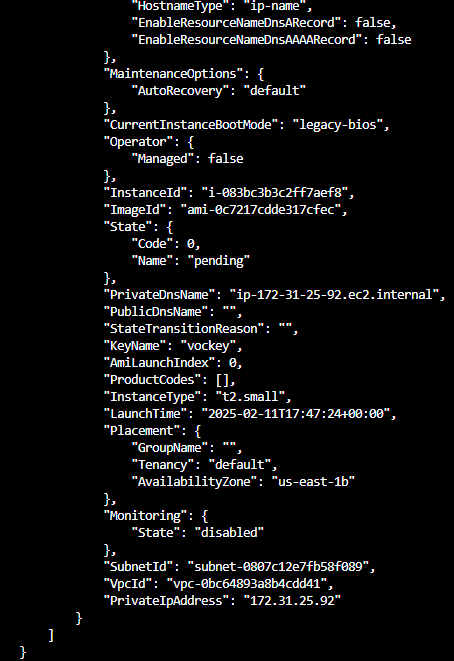

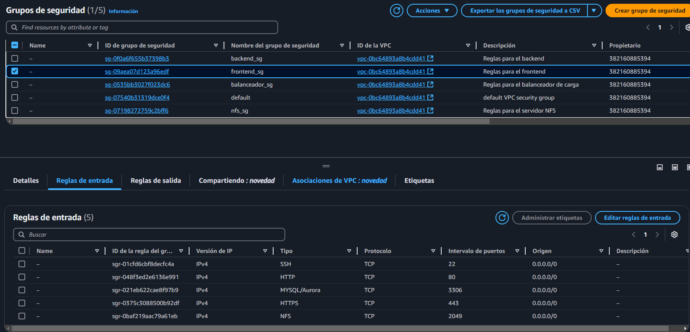


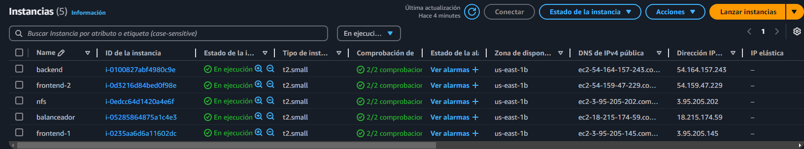

## Ejercicio 3.2. Crear un script para la eliminación de la infraestructura de la práctica 1.11.

```bash
#!/bin/bash
set -x

# Deshabilitamos la paginación de la salida de los comandos de AWS CLI
export AWS_PAGER=""

# Variables de configuración
source .env

# Eliminar instancias frontend, liberar IPs elásticas y esperar a que estén terminadas
for i in 1 2; do
  INSTANCE_ID=$(aws ec2 describe-instances \
                --filters "Name=tag:Name,Values=$INSTANCE_NAME_FRONTEND-$i" \
                          "Name=instance-state-name,Values=running" \
                --query "Reservations[*].Instances[*].InstanceId" \
                --output text)

  ELASTIC_IP_VAR="ELASTIC_IP_FRONTEND_$i"
  ELASTIC_IP=${!ELASTIC_IP_VAR}

  aws ec2 disassociate-address --public-ip $ELASTIC_IP
  aws ec2 release-address --public-ip $ELASTIC_IP
  aws ec2 terminate-instances --instance-ids $INSTANCE_ID
  aws ec2 wait instance-terminated --instance-ids $INSTANCE_ID
done

# Eliminar instancia backend, liberar IP elástica y esperar a que esté terminada
INSTANCE_ID_BACKEND=$(aws ec2 describe-instances \
                      --filters "Name=tag:Name,Values=$INSTANCE_NAME_BACKEND" \
                                "Name=instance-state-name,Values=running" \
                      --query "Reservations[*].Instances[*].InstanceId" \
                      --output text)

ELASTIC_IP_BACKEND=$ELASTIC_IP_BACKEND

aws ec2 disassociate-address --public-ip $ELASTIC_IP_BACKEND
aws ec2 release-address --public-ip $ELASTIC_IP_BACKEND
aws ec2 terminate-instances --instance-ids $INSTANCE_ID_BACKEND
aws ec2 wait instance-terminated --instance-ids $INSTANCE_ID_BACKEND

# Eliminar instancia balanceador, liberar IP elástica y esperar a que esté terminada
INSTANCE_ID_BALANCEADOR=$(aws ec2 describe-instances \
                          --filters "Name=tag:Name,Values=$INSTANCE_NAME_BALANCEADOR" \
                                    "Name=instance-state-name,Values=running" \
                          --query "Reservations[*].Instances[*].InstanceId" \
                          --output text)

ELASTIC_IP_BALANCEADOR=$ELASTIC_IP_BALANCEADOR

aws ec2 disassociate-address --public-ip $ELASTIC_IP_BALANCEADOR
aws ec2 release-address --public-ip $ELASTIC_IP_BALANCEADOR
aws ec2 terminate-instances --instance-ids $INSTANCE_ID_BALANCEADOR
aws ec2 wait instance-terminated --instance-ids $INSTANCE_ID_BALANCEADOR

# Eliminar instancia NFS, liberar IP elástica y esperar a que esté terminada
INSTANCE_ID_NFS=$(aws ec2 describe-instances \
                  --filters "Name=tag:Name,Values=$INSTANCE_NAME_NFS" \
                            "Name=instance-state-name,Values=running" \
                  --query "Reservations[*].Instances[*].InstanceId" \
                  --output text)

ELASTIC_IP_NFS=$ELASTIC_IP_NFS

aws ec2 disassociate-address --public-ip $ELASTIC_IP_NFS
aws ec2 release-address --public-ip $ELASTIC_IP_NFS
aws ec2 terminate-instances --instance-ids $INSTANCE_ID_NFS
aws ec2 wait instance-terminated --instance-ids $INSTANCE_ID_NFS

# Eliminar grupos de seguridad
aws ec2 delete-security-group --group-name $SECURITY_GROUP_FRONTEND
aws ec2 delete-security-group --group-name $SECURITY_GROUP_BACKEND
aws ec2 delete-security-group --group-name $SECURITY_GROUP_BALANCEADOR
aws ec2 delete-security-group --group-name $SECURITY_GROUP_NFS
```

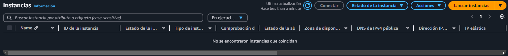
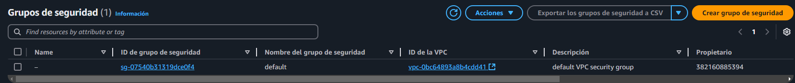
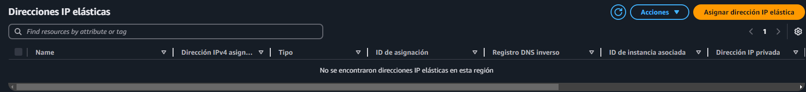

## Ejercicio 4. Modificar los scripts del repositorio de ejemplo para que utilicen la AMI de la última versión de Ubuntu Server. También modificar los scripts para que se ejecute el siguiente comando en las instancias durante el inicio: $ sudo apt update && sudo apt upgrade -y.

Para que los scripts utilicen la AMI de la última versión de ubuntu server, hay que modificar el .env con la AMI de la última versión de ubuntu server y para ello nos dirigimos al ec2 de amazon y miramos la AMI de la última versión de ubuntu server lanzando una instancia, como se puede ver en la imagen:

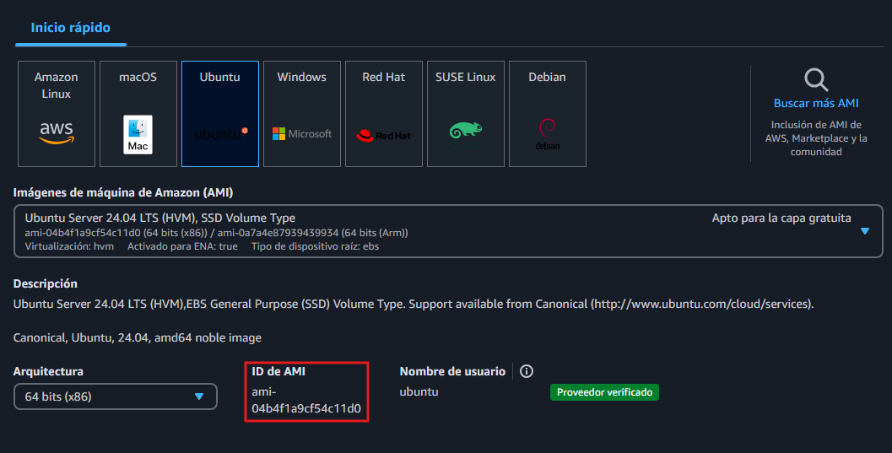

Y el .env quedaría tal que así:

```bash
AMI_ID=ami-04b4f1a9cf54c11d0
COUNT=1
INSTANCE_TYPE=t2.small
KEY_NAME=vockey

SECURITY_GROUP_FRONTEND=frontend-sg
SECURITY_GROUP_BACKEND=backend-sg

INSTANCE_NAME_FRONTEND=frontend
INSTANCE_NAME_BACKEND=backend
```

Y para que se ejecute el comando en las instancias durante el inicio hay que hacerlo así:

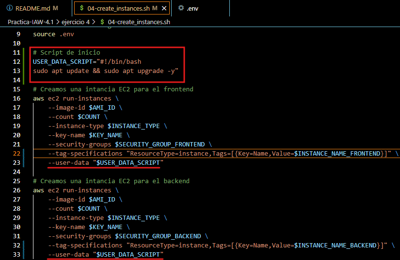

## Ejercicio 5. Escribir un script de bash que muestre el nombre de todas instancias EC2 que tiene en ejecución junto a su dirección IP pública.

```bash
#!/bin/bash

# Deshabilitamos la paginación de la salida de los comandos de AWS CLI
export AWS_PAGER=""

# Obtener todas las instancias en ejecución
INSTANCES=$(aws ec2 describe-instances --filters "Name=instance-state-name,Values=running" --query "Reservations[*].Instances[*].[InstanceId,Tags[?Key=='Name'].Value|[0],PublicIpAddress]" --output text)

# Imprimir resultados
echo -e "ID de la Instancia\t\tNombre\t\tDirección IP Pública"
echo -e "----------------------------------------------------------"
echo "$INSTANCES" | while read -r INSTANCE_ID INSTANCE_NAME PUBLIC_IP; do
    echo -e "$INSTANCE_ID\t$INSTANCE_NAME\t$PUBLIC_IP"
done
```


