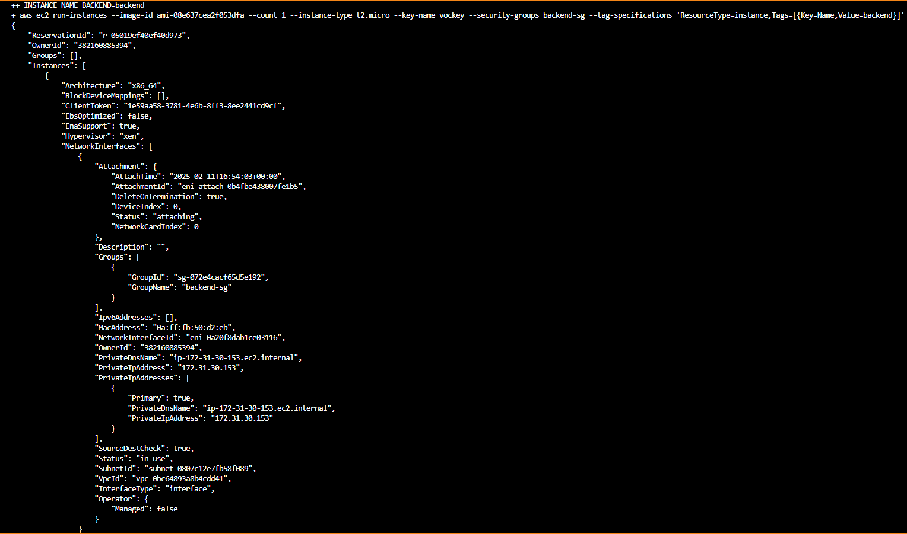
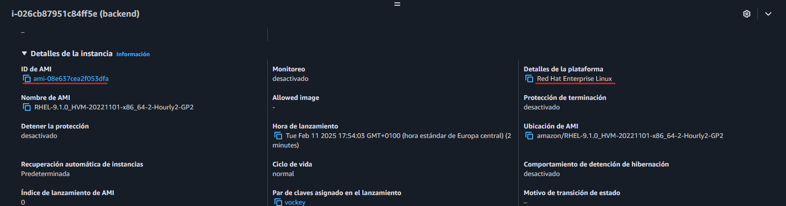
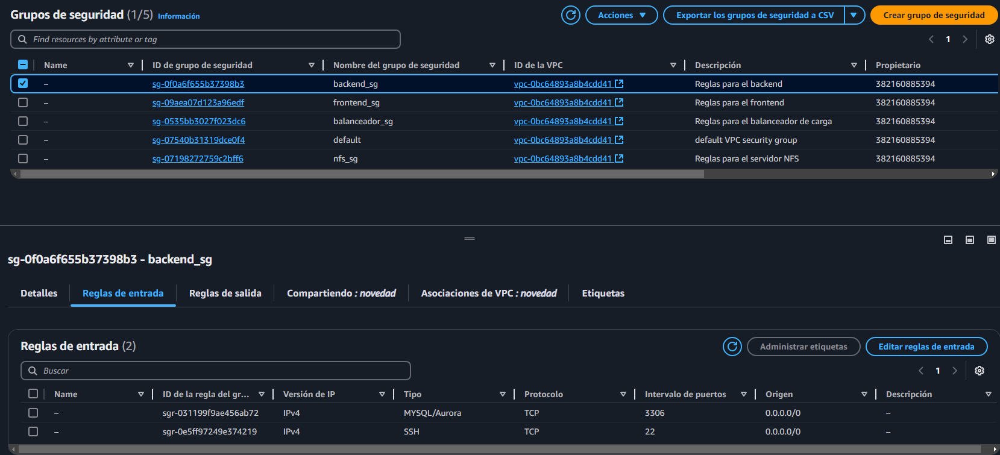
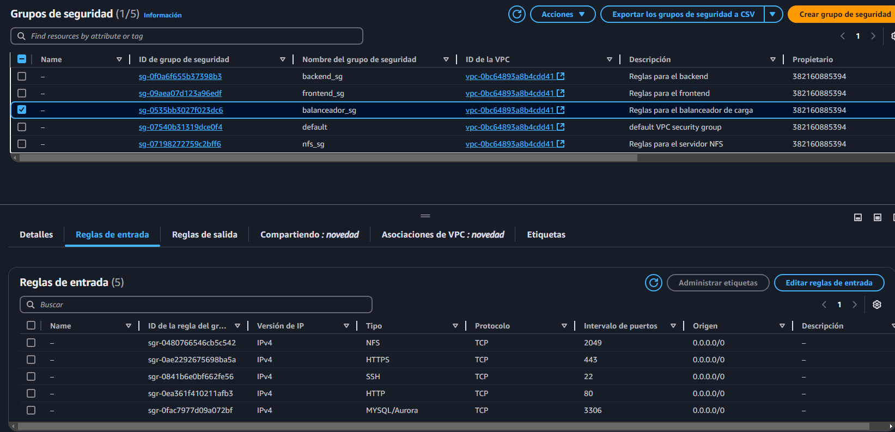
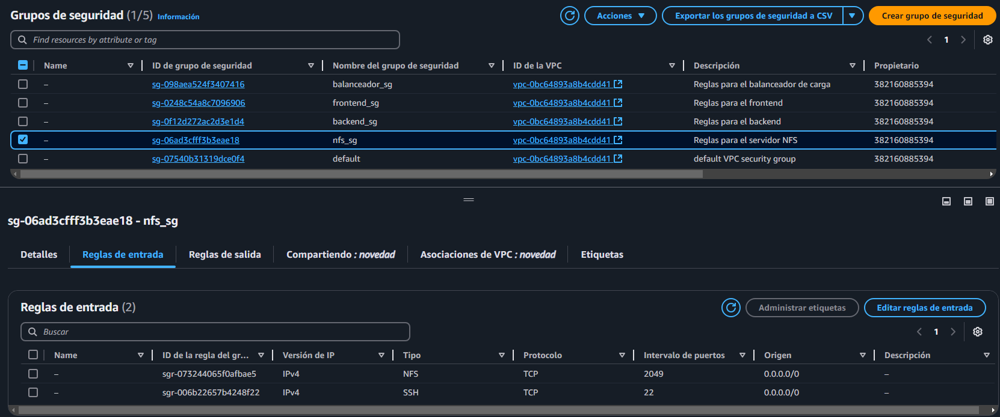

# Practica-IAW-4.1- Ejercicios con AWS CLI

## Ejercicio 1. Crear un grupo de seguridad para las máquinas del Backend con el nombre backend-sg con  Añada las reglas Acceso SSH (puerto 22/TCP) desde cualquier dirección IP y Acceso al puerto 3306/TCP desde cualquier dirección IP al grupo de seguridad:

```bash
#!/bin/bash
set -x

# Deshabilitamos la paginación de la salida de los comandos de AWS CLI
export AWS_PAGER=""

# Importamos las variables de entorno
source .env

# Creamos el grupo de seguridad: backend-sg
aws ec2 create-security-group \
    --group-name $SECURITY_GROUP_BACKEND \
    --description "Reglas para el backend"

# Creamos una regla de accesso SSH
aws ec2 authorize-security-group-ingress \
    --group-name $SECURITY_GROUP_BACKEND \
    --protocol tcp \
    --port 22 \
    --cidr 0.0.0.0/0

# Creamos una regla de accesso para MySQL
aws ec2 authorize-security-group-ingress \
    --group-name $SECURITY_GROUP_BACKEND \
    --protocol tcp \
    --port 3306 \
    --cidr 0.0.0.0/0
```


No se ve toda la ejecución del script porque es demasiado grande, pero para verificar que se ha hecho correctamente, voy a ir al ec2 en amazon para ver que a creado el grupo con las reglas correctamente.


Como se puede ver, a creado el grupo con el nombre indicado y con las reglas correctamente.

## Ejercicio 2. Crea una instancia EC2 para la máquina del Backend con las siguientes características. Identificador de la AMI: ami-08e637cea2f053dfa. Número de instancias: 1, Tipo de instancia: t2.micro, Clave privada: vockey, Grupo de seguridad: backend-sg, Nombre de la instancia: backend

```bash
#!/bin/bash
set -x

# Deshabilitamos la paginación de la salida de los comandos de AWS CLI
export AWS_PAGER=""

# Variables de configuración
source .env

# Creamos una intancia EC2 para el backend
aws ec2 run-instances \
    --image-id $AMI_ID \
    --count $COUNT \
    --instance-type $INSTANCE_TYPE \
    --key-name $KEY_NAME \
    --security-groups $SECURITY_GROUP_BACKEND \
    --tag-specifications "ResourceType=instance,Tags=[{Key=Name,Value=$INSTANCE_NAME_BACKEND}]"
```

El archivo de variables para este ejercicio quedaría tal que así:

```bash
AMI_ID=ami-08e637cea2f053dfa
COUNT=1
INSTANCE_TYPE=t2.micro
KEY_NAME=vockey

SECURITY_GROUP_FRONTEND=frontend-sg
SECURITY_GROUP_BACKEND=backend-sg

INSTANCE_NAME_FRONTEND=frontend
INSTANCE_NAME_BACKEND=backend
```





## Ejercicio 3.1. Crear un script para crear la infraestructura de la práctica 1.11.

```bash
#!/bin/bash
set -x

# Deshabilitamos la paginación de la salida de los comandos de AWS CLI
export AWS_PAGER=""

# Variables de configuración
source .env

# Creamos el grupo de seguridad: frontend-sg
aws ec2 create-security-group --group-name $SECURITY_GROUP_FRONTEND --description "Reglas para el frontend"
aws ec2 authorize-security-group-ingress --group-name $SECURITY_GROUP_FRONTEND --protocol tcp --port 22 --cidr 0.0.0.0/0
aws ec2 authorize-security-group-ingress --group-name $SECURITY_GROUP_FRONTEND --protocol tcp --port 2049 --cidr 0.0.0.0/0
aws ec2 authorize-security-group-ingress --group-name $SECURITY_GROUP_FRONTEND --protocol tcp --port 80 --cidr 0.0.0.0/0
aws ec2 authorize-security-group-ingress --group-name $SECURITY_GROUP_FRONTEND --protocol tcp --port 443 --cidr 0.0.0.0/0
aws ec2 authorize-security-group-ingress --group-name $SECURITY_GROUP_FRONTEND --protocol tcp --port 3306 --cidr 0.0.0.0/0

# Creamos el grupo de seguridad: backend-sg
aws ec2 create-security-group --group-name $SECURITY_GROUP_BACKEND --description "Reglas para el backend"
aws ec2 authorize-security-group-ingress --group-name $SECURITY_GROUP_BACKEND --protocol tcp --port 22 --cidr 0.0.0.0/0
aws ec2 authorize-security-group-ingress --group-name $SECURITY_GROUP_BACKEND --protocol tcp --port 3306 --cidr 0.0.0.0/0

# Creamos el grupo de seguridad: balanceador-sg
aws ec2 create-security-group --group-name $SECURITY_GROUP_BALANCEADOR --description "Reglas para el balanceador de carga"
aws ec2 authorize-security-group-ingress --group-name $SECURITY_GROUP_BALANCEADOR --protocol tcp --port 22 --cidr 0.0.0.0/0
aws ec2 authorize-security-group-ingress --group-name $SECURITY_GROUP_BALANCEADOR --protocol tcp --port 3306 --cidr 0.0.0.0/0
aws ec2 authorize-security-group-ingress --group-name $SECURITY_GROUP_BALANCEADOR --protocol tcp --port 80 --cidr 0.0.0.0/0
aws ec2 authorize-security-group-ingress --group-name $SECURITY_GROUP_BALANCEADOR --protocol tcp --port 443 --cidr 0.0.0.0/0
aws ec2 authorize-security-group-ingress --group-name $SECURITY_GROUP_BALANCEADOR --protocol tcp --port 2049 --cidr 0.0.0.0/0

# Creamos el grupo de seguridad: nfs-sg
aws ec2 create-security-group --group-name $SECURITY_GROUP_NFS --description "Reglas para el servidor NFS"
aws ec2 authorize-security-group-ingress --group-name $SECURITY_GROUP_NFS --protocol tcp --port 22 --cidr 0.0.0.0/0
aws ec2 authorize-security-group-ingress --group-name $SECURITY_GROUP_NFS --protocol tcp --port 2049 --cidr 0.0.0.0/0

# Crear instancias EC2 para el frontend
for i in {1..2}; do
  aws ec2 run-instances \
    --image-id $AMI_ID \
    --count 1 \
    --instance-type $INSTANCE_TYPE \
    --key-name $KEY_NAME \
    --security-groups $SECURITY_GROUP_FRONTEND \
    --tag-specifications "ResourceType=instance,Tags=[{Key=Name,Value=frontend-$i}]"
done

# Crear una instancia EC2 para el backend
aws ec2 run-instances \
    --image-id $AMI_ID \
    --count 1 \
    --instance-type $INSTANCE_TYPE \
    --key-name $KEY_NAME \
    --security-groups $SECURITY_GROUP_BACKEND \
    --tag-specifications "ResourceType=instance,Tags=[{Key=Name,Value=$INSTANCE_NAME_BACKEND}]"

# Crear una instancia EC2 para el balanceador de carga
aws ec2 run-instances \
    --image-id $AMI_ID \
    --count 1 \
    --instance-type $INSTANCE_TYPE \
    --key-name $KEY_NAME \
    --security-groups $SECURITY_GROUP_BALANCEADOR \
    --tag-specifications "ResourceType=instance,Tags=[{Key=Name,Value=$INSTANCE_NAME_BALANCEADOR}]"

# Crear una instancia EC2 para el NFS
aws ec2 run-instances \
    --image-id $AMI_ID \
    --count 1 \
    --instance-type $INSTANCE_TYPE \
    --key-name $KEY_NAME \
    --security-groups $SECURITY_GROUP_NFS \
    --tag-specifications "ResourceType=instance,Tags=[{Key=Name,Value=$INSTANCE_NAME_NFS}]"
```





